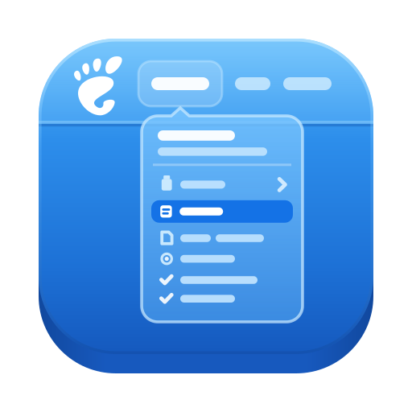
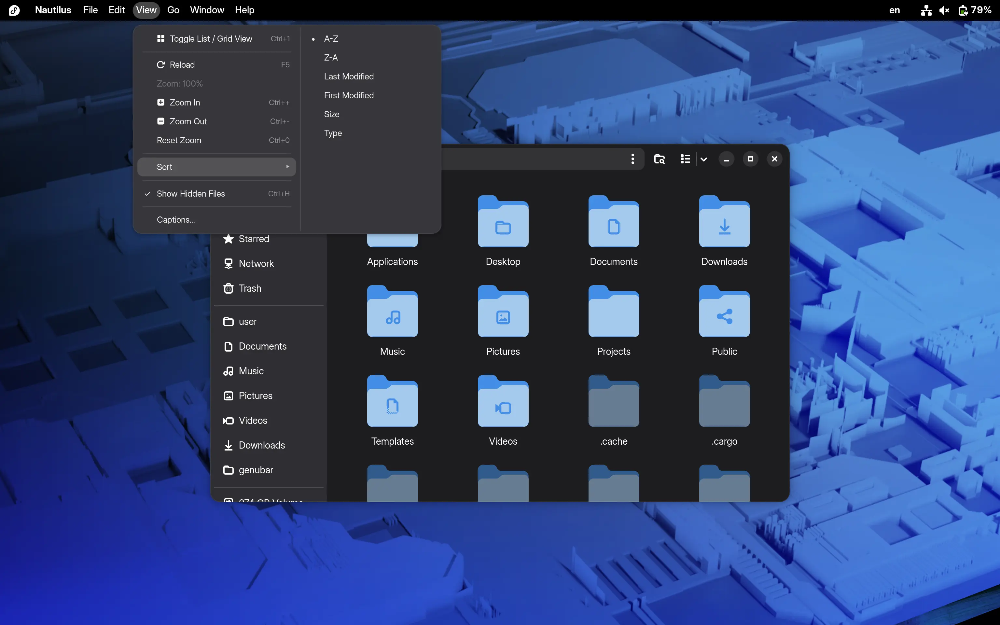
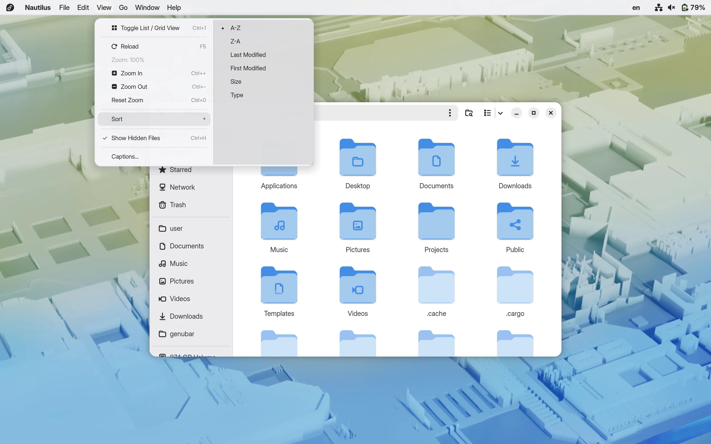
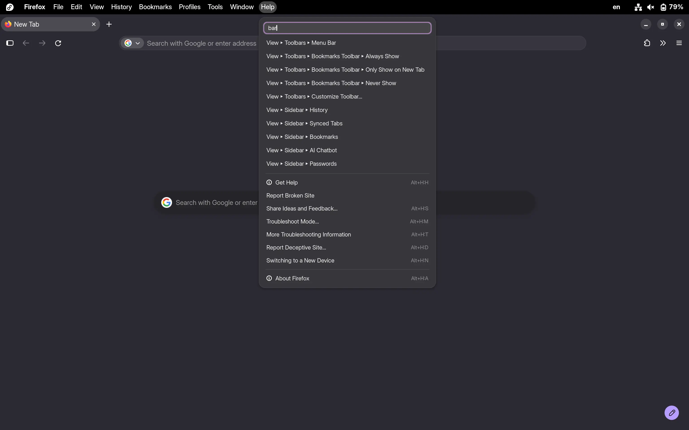

#  Genubar GNOME Shell Extension

GNOME Shell extension (`genubar@github.com`) for **GNOME on Wayland** (GNOME Shell 47+, with `shell-version` 47–51 in `metadata.json`; supporting native Wayland and XWayland applications) that renders the top-panel global menubar driven over session D-Bus by `genubar-daemon`.

> **Core Ecosystem Links**
> - **Core Daemon, Installer, GTK4 Hook & Settings App:** [genubar/genubar](https://github.com/genubar/genubar) ([Latest Releases](https://github.com/genubar/genubar/releases))
> - **Release & Package Feeds:** [genubar/genubar-registry](https://github.com/genubar/genubar-registry)

## Screenshots

| Dark Mode (Nautilus) | Light Mode (Nautilus) |
| --- | --- |
|  |  |



---

## Prerequisites & Why This Extension Exists

This extension is the GNOME Shell frontend for [genubar](https://github.com/genubar/genubar) — it requires `genubar-daemon` running in your user session (installed automatically by `genubar-installer`).

On Wayland, clients are isolated from one another and cannot inspect global window focus or other windows' metadata. Only the GNOME Shell compositor has access to window focus tracking (`global.display`), window metadata (`app_id`, titles, GTK `GMenuModel` D-Bus paths, and XWayland XIDs), the top panel bar, and input synthesis. `genubar@github.com` keeps panel layout, styling, focus notifications, fast L0 caching, and lazy UI rendering directly inside GNOME Shell while delegating application menu extraction, profiles, icons, and patch management to `genubar-daemon`.

---

## Architecture

<details>
<summary>Extension Directory & Module Structure</summary>

```text
genubar-gnome-extension/
├── extension.js                 # Extension lifecycle (enable/disable) & composition root
├── metadata.json                # Extension UUID, Shell 47–51 versions & IPC compat metadata
├── stylesheet.css               # Default Dark/Light top-panel, menu & search entry styles
├── lib/
│   ├── core/                    # Pure JS domain logic (zero GI/Shell imports)
│   │   ├── textUtils.js         # Mnemonic cleanup, middle truncation, SemVer compare
│   │   ├── menuModel.js         # Menu tree predicates, separator hygiene, search collection
│   │   ├── slotLayout.js        # Icon/Check/Radio column reserve & row state resolution
│   │   ├── l0Cache.js           # Bounded LRU L0 cache by PID, app_id, and Desktop fallback
│   │   └── menuStore.js         # Reactive active menu store with focusSeq race protection
│   ├── ipc/                     # Session D-Bus communication
│   │   ├── dbusClient.js        # Proxy wrapper for org.genubar.WindowTracker & onVanished
│   │   └── versionCheck.js      # GetDaemonInfo compatibility handshake
│   ├── platform/                # GNOME Shell / Mutter / Clutter platform adapters
│   │   ├── windowActions.js     # Window management actions (close, minimize, maximize, tile, etc.)
│   │   ├── shortcuts.js         # Keyboard shortcut synthesis via Clutter virtual input device (evdev keycodes)
│   │   ├── actionRegistry.js    # Unified ActionDispatcher (window, clipboard transforms, daemon)
│   │   ├── focusTracker.js      # Display focus & background window close/title tracking
│   │   ├── panelAdapter.js      # Top panel insertion, clock offset sync, dynamic panel width
│   │   └── themeManager.js      # Adwaita Light/Dark detection & CSS panel/menu classes
│   └── ui/                      # St / PanelMenu widgets & cascading popup menus
│       ├── iconCache.js         # Bounded LRU Gio.Icon cache (system symbolic + custom SVG/PNG)
│       ├── menuBar.js           # Pooled panel MenuButton bar controller
│       ├── menuButton.js        # Panel button wrapper owning a lazy CascadeController
│       ├── cascadeController.js # Lazy column + multi-level hover submenu controller
│       ├── menuColumn.js        # Scrollable column builder & separator/search layout
│       ├── menuRow.js           # Unified row factory (labels, icons, check/radio, shortcuts)
│       ├── searchWidget.js      # Inline SearchBar entry filtering all leaf actions live
│       └── windowListExpander.js# Expands synthetic WindowList nodes into live window items
└── tests/
    └── core.test.mjs            # Unit tests runnable under GJS (`gjs -m tests/core.test.mjs`)
```

</details>

---

## IPC & Compatibility Matrix

The extension communicates exclusively with `org.genubar.WindowTracker` (`/org/genubar/WindowTracker`):

| Direction | Member | Purpose |
| --- | --- | --- |
| Extension -> Daemon | `NotifyFocusChanged(...)` | Reports focused `pid`, `xid`, `title`, `app_id`, and extracted `GMenu` bus paths |
| Extension -> Daemon | `GetActiveMenu()` | Fetches initial active menu when connecting to a running daemon |
| Extension -> Daemon | `FetchSubmenu(id)` | Lazily resolves unexpanded submenus (AT-SPI2, Canonical DBusMenu) |
| Extension -> Daemon | `ActivateItem(id)` | Executes an item via daemon/app action bridge |
| Extension -> Daemon | `GetDaemonInfo()` | Returns `(daemon_version, expected_extension_version, ipc_protocol_version)` |
| Daemon -> Extension | `ActiveMenuChanged(json)` | Pushes finalized menu columns, `UiRenderConfig`, icons, and styles |

`metadata.json` enforces bidirectional compatibility during startup and updates:

| Field | Current Value | Meaning |
| --- | --- | --- |
| `uuid` | `genubar@github.com` | Extension identifier installed under `~/.local/share/gnome-shell/extensions/` |
| `shell-version` | `["47", "48", "49", "50", "51"]` | Declared compatible GNOME Shell major versions |
| `genubar-version` | `0.1.1` | Extension semantic version |
| `min-daemon-version` | `0.1.0` | Minimum required `genubar-daemon` version |
| `tested-daemon-version` | `0.1.0` | Latest daemon version verified against this release |
| `ipc-protocol-version` | `1` | D-Bus contract version checked at runtime via `GetDaemonInfo` |

If the running daemon reports an incompatible `ipc-protocol-version` or older version than `min-daemon-version`, the extension notifies the user via `Main.notify`.

---

## Installation

### Method 1: Via Genubar Installer (Recommended)

Download the release archive from the [Genubar Releases](https://github.com/genubar/genubar/releases) page — `genubar-installer` embeds this extension and deploys it alongside `genubar-daemon` and `genubar.service`:

```bash
# Full install (daemon + CLI + settings GUI + GTK4 hook + extension)
./genubar-installer --install

# Or install/sync only the GNOME Shell extension
./genubar-installer --install-extension
```

Alternatively, inside **Genubar Settings -> About & Updates**, click **Install / Sync Local** (or **Update Extension** when a newer release appears in [genubar-registry](https://github.com/genubar/genubar-registry)).

### Method 2: Manual Installation

Run from inside a cloned `genubar-gnome-extension/` checkout (release `.zip` archives only include `metadata.json`, `extension.js`, `stylesheet.css`, `lib/`, and `LICENSE`, excluding `docs/` and `tests/`):

```bash
EXT_DIR="$HOME/.local/share/gnome-shell/extensions/genubar@github.com"
mkdir -p "$EXT_DIR"
cp -r metadata.json extension.js stylesheet.css lib "$EXT_DIR"/
gnome-extensions enable genubar@github.com
```

For active extension development, you can symlink the repository checkout instead of copying (remember GNOME Shell still caches loaded ESM modules until a session restart):

```bash
rm -rf "$HOME/.local/share/gnome-shell/extensions/genubar@github.com"
ln -s "$PWD" "$HOME/.local/share/gnome-shell/extensions/genubar@github.com"
gnome-extensions enable genubar@github.com
```

---

## Reloading & Troubleshooting

- **Reloading on GNOME Wayland:** Shell extensions cannot be hot-reloaded in-place. After installing or updating files, log out and log back in (or test changes safely inside a nested Wayland session: `dbus-run-session -- gnome-shell --nested --wayland`).
- **Verify extension status & logs:**
  ```bash
  gnome-extensions info genubar@github.com
  journalctl -f /usr/bin/gnome-shell
  ```
- **Daemon offline / empty panel:** Ensure `systemctl --user status genubar.service` is active. When the daemon vanishes (`onVanished`), the extension clears top-panel buttons cleanly and resumes automatically as soon as `genubar-daemon` reappears on session D-Bus.

---

## Testing & Verification

```bash
# Syntax check all ESM sources
node --check extension.js && find lib tests -type f \( -name "*.js" -o -name "*.mjs" \) -exec node --check {} +

# Run core logic unit tests in GNOME's native GJS runtime
gjs -m tests/core.test.mjs
```

## License

Licensed under the [MIT License](LICENSE).

## Acknowledgments

AI-assisted tooling (Google Gemini) was used for API research, refactoring, and documentation editing. All changes are manually reviewed, tested on GNOME Wayland, and maintained by the author.
